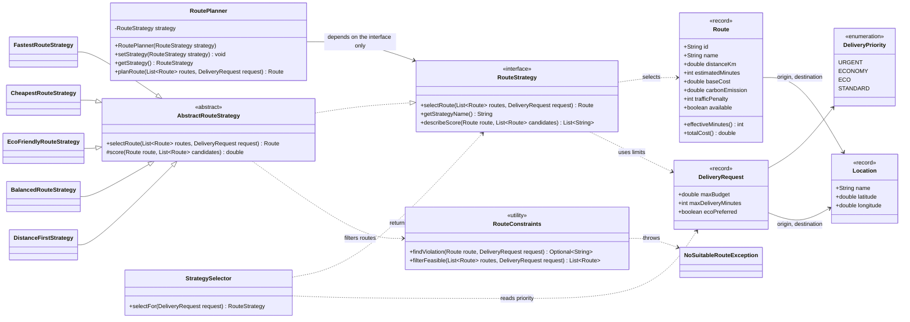
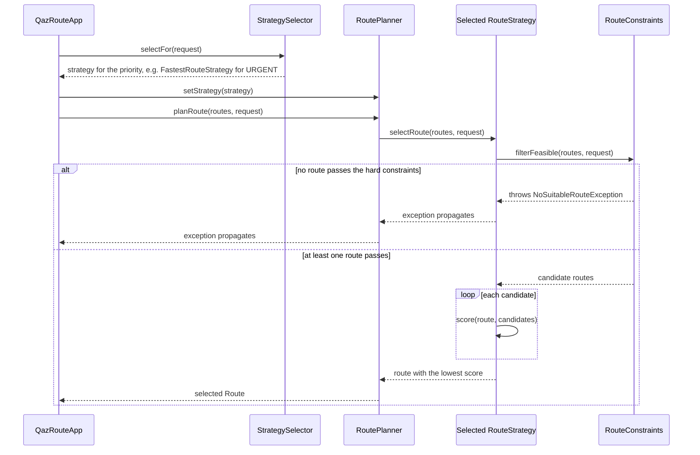

# QazRoute - Regional Logistics Optimizer

**Smart Delivery & Route Optimization Engine** - a Java 17 console application that demonstrates the
**Strategy Pattern** by choosing a transportation route between cities in Kazakhstan.

> **Data disclaimer:** all routes, prices, times and CO2 values in this project are **fictional and illustrative**.
> They are deterministic demo data, **not** real-time road, GPS or logistics data. No maps, routing APIs,
> databases or graphical interfaces are used.

---

## 1. Project description

QazRoute is a fictional transport company operating between Astana, Karaganda, Kokshetau, Pavlodar, Kostanay and Semey.
A delivery request says *where* the goods go, *how much* the customer can pay, *how long* they can wait and *what matters most*.
The program receives a list of candidate routes and picks one using a **RouteStrategy**.

The point of the project: **the same transportation problem gives different answers when the strategy changes**,
and the strategy can be changed at runtime without touching the planner.

For the demo request (Astana -> Semey, budget 80,000 KZT, deadline 900 minutes) the five strategies choose five different routes.

## 2. Features

- Domain model with validation: `Location`, `Route`, `DeliveryRequest`, `DeliveryPriority` (Java records and an enum).
- `RouteStrategy` interface with **five** strategies: Fastest, Cheapest, EcoFriendly, Balanced and DistanceFirst.
- `RoutePlanner` (Context) that delegates to the current strategy and can switch strategy at runtime.
- `StrategySelector` that maps the delivery priority to a strategy automatically.
- Hard constraints shared by all strategies (availability, budget, deadline, city pair) and a custom `NoSuitableRouteException`.
- **Comparison mode**: all strategies solve the same request and the results are shown in one table.
- **Explanations**: why a route was selected and why other routes were rejected.
- 58 JUnit 5 tests and two Mermaid UML diagrams.

## 3. Java version and how to run

- **Java 17 or newer** (the code was compiled with `--release 17`) and **Maven 3.8+**.
- The only dependency is JUnit 5 (test scope).

```bash
# Build the jar and run the demo
mvn clean package
java -jar target/qazroute-1.0.0.jar
```

Alternative without building a jar:

```bash
mvn compile
java -cp target/classes kz.qazroute.app.QazRouteApp
```

In IntelliJ IDEA: *File -> Open* the `pom.xml` (open as project), wait for Maven to import, open
`src/main/java/kz/qazroute/app/QazRouteApp.java` and press the green run arrow next to `main`.

## 4. Maven commands for running tests

```bash
mvn test            # compile and run all JUnit 5 tests
mvn clean test      # same, from a clean build
mvn -Dtest=HardConstraintsTest test    # run one test class
```

## 5. Architecture explanation

```text
src/main/java/kz/qazroute
├── model        Location, Route, DeliveryRequest, DeliveryPriority      (data + validation)
├── exception    NoSuitableRouteException
├── strategy     RouteStrategy (interface)
│                AbstractRouteStrategy (shared selection steps)
│                RouteConstraints (hard constraints, written once)
│                FastestRouteStrategy, CheapestRouteStrategy, EcoFriendlyRouteStrategy,
│                BalancedRouteStrategy, DistanceFirstStrategy
├── planner      RoutePlanner (Context), StrategySelector
└── app          QazRouteApp (main), SampleData, RouteExplainer, StrategyComparison
src/test/java/kz/qazroute   58 JUnit 5 tests
```

How one request flows through the system:

1. `StrategySelector` looks at the request priority and returns a strategy.
2. `RoutePlanner` stores that strategy and calls `selectRoute(routes, request)` on it.
3. The strategy removes routes that break a **hard constraint** (`RouteConstraints`), scores the rest and returns the route with the **lowest score**.
4. If nothing is left, a `NoSuitableRouteException` is thrown.

`AbstractRouteStrategy` contains steps 3-4 once, so every concrete strategy only has to say **how it scores a route**
(`score(route, candidates)`) and **how to describe that score** (`describeScore`). There is no copy-pasted filtering code.

## 6. Strategy Pattern explanation

The Strategy Pattern puts a family of interchangeable algorithms behind one interface so that the client can choose
(and change) the algorithm at runtime.

| Pattern role | In QazRoute |
|---|---|
| **Context** | `RoutePlanner` |
| **Strategy (interface)** | `RouteStrategy` |
| **Concrete strategies** | `FastestRouteStrategy`, `CheapestRouteStrategy`, `EcoFriendlyRouteStrategy`, `BalancedRouteStrategy`, `DistanceFirstStrategy` |
| **Client** | `QazRouteApp` (and the tests) |

Without the pattern, `RoutePlanner` would contain one big `if/else` or `switch` over strategy names, and every new
algorithm would force us to edit and re-test that class. With the pattern, a new algorithm is a new class.

## 7. Responsibilities of Context, Strategy and StrategySelector

| Class | Responsibility | Does NOT do |
|---|---|---|
| `RoutePlanner` (Context) | Holds a `RouteStrategy`, lets you change it with `setStrategy()`, delegates `planRoute()` | Contains no optimization algorithm, no `instanceof`, no `switch` on strategy names |
| `RouteStrategy` (Strategy) | Contract: select a route, report its name, describe a score | Knows nothing about the planner |
| Concrete strategies | Each implements exactly **one** optimization rule | Do not duplicate constraint checking |
| `StrategySelector` | Maps `DeliveryPriority` to a strategy object | Does not select routes itself |

## 8. Explanation of the optimization formulas

Every strategy assigns a **score** to each remaining route and the **lowest score wins**. If two routes have the same
score, the smaller route id wins, so results are always deterministic.

Two derived values live in `Route`, so every class agrees on what "time" and "cost" mean:

```text
effectiveMinutes = estimatedMinutes + trafficPenalty
totalCost        = baseCost + distanceKm * 50 KZT/km
```

| Strategy | Score (lower is better) | Why lower is better |
|---|---|---|
| **Fastest** | `effectiveMinutes` | Less time on the road |
| **Cheapest** | `totalCost` = base cost + distance cost | Less money. The base cost is a fixed fee (loading, handling, tolls); the distance cost grows with kilometres |
| **EcoFriendly** | `ecoScore = carbonEmission * 0.7 + distanceKm * 0.3` | Every kg of CO2 and every extra kilometre harms the environment, so a smaller sum means a cleaner route. CO2 gets the larger weight because it is the direct measurement of harm |
| **DistanceFirst** | `distanceKm` | Fewer kilometres |
| **Balanced** | `0.40 * normTime + 0.30 * normCost + 0.10 * normDistance + 0.20 * normEmission` | 0 = best of the group, 1 = worst; a small weighted sum means a good compromise |

### Balanced strategy: min-max normalization

Minutes, KZT, kilometres and kilograms cannot be added directly. Each criterion is converted to a number between 0 and 1
**among the routes that passed the hard constraints**:

```text
normalized = (value - min) / (max - min)        (if max == min, the criterion counts as 0)
```

Worked example for the winner R8 (feasible routes: R1, R3, R5, R7, R8):

| Criterion | R8 value | min | max | normalized | weight | contribution |
|---|---|---|---|---|---|---|
| Effective time | 835 min | 820 | 895 | 0.200 | 0.40 | 0.0800 |
| Total cost | 66,500 KZT | 62,000 | 74,000 | 0.375 | 0.30 | 0.1125 |
| Distance | 1,050 km | 960 | 1,120 | 0.563 | 0.10 | 0.0563 |
| CO2 | 110 kg | 40 | 245 | 0.341 | 0.20 | 0.0683 |
| **Balanced score** | | | | | | **0.317** (lowest of all) |

The four weights must be **non-negative and add up to 1.0**; anything else throws `IllegalArgumentException`
when the strategy is created.

## 9. Hard constraints and exception handling

A route is rejected **before scoring** if it breaks any of these rules (`RouteConstraints`, used by every strategy):

1. It does not connect the requested origin and destination.
2. It is unavailable.
3. `totalCost` is greater than the request budget.
4. `effectiveMinutes` (travel time **plus traffic penalty**) is greater than the deadline - this applies to all strategies, not only the fastest one.

Because rejection happens first, a route that breaks a rule can **never** win, whatever its score.
Limits are inclusive: a route that costs exactly the budget is accepted.

| Situation | Result |
|---|---|
| Empty route list | `NoSuitableRouteException` ("the route list is empty") |
| Every route is rejected | `NoSuitableRouteException`, message lists the reason for each rejected route |
| Only unavailable routes | `NoSuitableRouteException` |
| `null` request or `null` route list | `IllegalArgumentException` |
| Negative distance / cost / time, bad coordinates | `IllegalArgumentException` when the object is created |
| Invalid Balanced or Eco weights | `IllegalArgumentException` when the strategy is created |
| `null` strategy given to `RoutePlanner` | `IllegalArgumentException` |

No strategy ever returns `null`, and no exception is swallowed silently. The only place that catches
`NoSuitableRouteException` is comparison mode, which prints the failure in the table and continues.

## 10. Runtime switching example

```java
RoutePlanner planner = new RoutePlanner(new FastestRouteStrategy());
Route r1 = planner.planRoute(routes, request);      // R1

planner.setStrategy(new CheapestRouteStrategy());   // same planner object
Route r2 = planner.planRoute(routes, request);      // R3

planner.setStrategy(new EcoFriendlyRouteStrategy());
Route r3 = planner.planRoute(routes, request);      // R5
```

Console output (Demo 1) for the first switch:

```text
>>> RoutePlanner now uses: FastestRouteStrategy
Selected route: R1 (Direct Highway via Pavlodar)
Strategy: FastestRouteStrategy
Base estimated time: 780 minutes
Traffic penalty: 40 minutes
Effective time: 820 minutes (lowest wins)

Rejected route R2:
  Budget exceeded (93000 KZT > 80000 KZT).

Rejected route R4:
  Deadline exceeded (1060 min > 900 min).

Rejected route R6:
  Route is unavailable.
Result: R1 Direct Highway via Pavlodar
```

## 11. Comparison mode example

`StrategyComparison.compare(strategies, routes, request)` runs every strategy on the same request:

```text
Strategy                 | Selected route                    | Time (min) |  Cost (KZT) | Distance (km) | CO2 (kg)
------------------------------------------------------------------------------------------------------------------
FastestRouteStrategy     | R1 Direct Highway via Pavlodar    |        820 |      74,000 |         1,000 |      230
CheapestRouteStrategy    | R3 Rail Freight via Karaganda     |        880 |      62,000 |         1,120 |       70
EcoFriendlyRouteStrategy | R5 Electric Truck via Karaganda   |        850 |      73,000 |         1,060 |       40
BalancedRouteStrategy    | R8 Mixed Rail-Road via Karaganda  |        835 |      66,500 |         1,050 |      110
```

If a strategy cannot find a route it is shown as `NO SUITABLE ROUTE` and the other strategies still run
(see Demo 3 in the program output, where the budget is only 10,000 KZT).

## 12. How to add the fifth strategy

`DistanceFirstStrategy` was added after the four required strategies. Steps (the same steps work for any new strategy):

1. Create a class that extends `AbstractRouteStrategy` (which implements `RouteStrategy`).
2. Implement `getStrategyName()`, `score()` (lower is better) and `describeScore()`.
3. Use it: `planner.setStrategy(new DistanceFirstStrategy());`

```java
public class DistanceFirstStrategy extends AbstractRouteStrategy {
    @Override public String getStrategyName() { return "DistanceFirstStrategy"; }
    @Override protected double score(Route route, List<Route> candidates) { return route.distanceKm(); }
    @Override public List<String> describeScore(Route route, List<Route> candidates) {
        return List.of(String.format(Locale.US, "Distance: %.0f km (lowest wins)", route.distanceKm()));
    }
}
```

**`RoutePlanner` was not modified** - that is the Open/Closed Principle in action. The hard constraints are applied
automatically because they live in the shared base class. The test `fifthStrategyWorksWithUnchangedPlanner` proves it.

## 13. UML class diagram



`RoutePlanner` has a single arrow to `RouteStrategy` (the interface) and no arrow to any concrete strategy.

## 14. UML sequence diagram



## 15. Example console output

The full program prints a banner, the 8 sample routes and five demos. Excerpts (run the program for everything):

```text
================================================================================
 QazRoute - Regional Logistics Optimizer
 Smart Delivery & Route Optimization Engine (Strategy Pattern demo)
================================================================================
Note: all routes and metrics are fictional demo data, not real-time logistics data.

SAMPLE ROUTES (candidate routes, Astana -> Semey)
Id  Name                            Available Time(min)   Cost(KZT)  Dist(km)  CO2(kg)
R1  Direct Highway via Pavlodar     yes             820      74,000     1,000      230
R2  Express Toll Road via Pavlodar  yes             650      93,000     1,020      250
R3  Rail Freight via Karaganda      yes             880      62,000     1,120       70
R4  Northern Loop via Kostanay      yes            1060      75,000     1,400      320
R5  Electric Truck via Karaganda    yes             850      73,000     1,060       40
R6  Night Shuttle via Pavlodar      NO              600      64,000       980      200
R7  Regional Road via Kokshetau     yes             895      66,000       960      245
R8  Mixed Rail-Road via Karaganda   yes             835      66,500     1,050      110

DEMO 2: AUTOMATIC STRATEGY SELECTION (StrategySelector)
URGENT                   -> FastestRouteStrategy     -> R1 Direct Highway via Pavlodar
ECONOMY                  -> CheapestRouteStrategy    -> R3 Rail Freight via Karaganda
ECO                      -> EcoFriendlyRouteStrategy -> R5 Electric Truck via Karaganda
STANDARD                 -> BalancedRouteStrategy    -> R8 Mixed Rail-Road via Karaganda
STANDARD + ecoPreferred  -> BalancedRouteStrategy    -> R5 Electric Truck via Karaganda

DEMO 4: FIFTH STRATEGY - DistanceFirstStrategy (RoutePlanner was not changed)
>>> RoutePlanner now uses: DistanceFirstStrategy
Selected route: R7 (Regional Road via Kokshetau)
Strategy: DistanceFirstStrategy
Distance: 960 km (lowest wins)
...
DistanceFirstStrategy    | R7 Regional Road via Kokshetau    |        895 |      66,000 |           960 |      245

DEMO 5: FAILURE SCENARIOS (every error is reported, none is hidden)
1. Empty route list
    NoSuitableRouteException: The route list is empty: there is nothing to choose from.
3. Invalid balanced weights (sum is 2.0)
    IllegalArgumentException: Balanced weights must add up to 1.0, but they add up to 2.0
5. Negative distance
    IllegalArgumentException: Route X1: distance must be positive, got -50.0
6. Missing (null) delivery request
    IllegalArgumentException: Delivery request must not be null.
```

Why these routes? R2 is the fastest overall but over budget, R4 is too slow, and R6 would be fast but is unavailable -
so the hard constraints visibly change the outcome. Among the five feasible routes (R1, R3, R5, R7, R8) each strategy has a different winner.

## 16. Test results

58 JUnit 5 tests in 7 classes (`src/test/java`):

| Test class | Tests | What it covers |
|---|---|---|
| `StrategySelectionTest` | 13 | Fastest, Cheapest, Eco, Balanced, DistanceFirst pick the expected route; traffic penalty; cost formula; eco weights; tie-break by id |
| `HardConstraintsTest` | 12 | Budget, deadline (effective time), unavailable route, inclusive limits, no suitable route, empty list, null input, wrong city pair |
| `StrategySelectorTest` | 8 | URGENT / ECONOMY / ECO / STANDARD mapping, `ecoPreferred`, selector + planner end to end |
| `DomainValidationTest` | 8 | Negative distance / cost / time, request and location validation, derived formulas |
| `ExplanationAndComparisonTest` | 7 | Explanation text, comparison table, a failing strategy does not crash comparison mode |
| `StrategyWeightsValidationTest` | 6 | Invalid Balanced and Eco weights |
| `RoutePlannerTest` | 4 | Runtime switching, fifth strategy with the unchanged planner, delegation, null strategy |

Every assertion checks a concrete route id, value, text or exception (no "is not null" tests).

Run them with `mvn test`; Maven prints `Tests run: 58, Failures: 0, Errors: 0, Skipped: 0` when everything passes.
Keep that console summary as evidence for the defense.

## 17. SOLID principles

- **S - Single Responsibility:** `RoutePlanner` only delegates; each strategy implements one optimization rule;
  `StrategySelector` only maps priority to strategy; `RouteConstraints` only checks hard rules.
- **O - Open/Closed:** adding `DistanceFirstStrategy` required **no change** to `RoutePlanner` (nor to any existing strategy).
- **L - Liskov Substitution:** any `RouteStrategy` can replace another inside `RoutePlanner`; the tests even use strategy classes written inside the test.
- **I - Interface Segregation:** `RouteStrategy` has only three small methods, all used by the program.
- **D - Dependency Inversion:** `RoutePlanner` depends on the `RouteStrategy` abstraction, not on concrete algorithms.

## 18. Limitations of the current implementation

- Data is fictional and fixed; there is no real map, traffic or fuel-price data, and no persistence.
- The system **chooses among routes it is given**; it does not search a road network or combine several legs.
- The cost formula is deliberately simple (one rate of 50 KZT/km for every transport mode).
- Min-max normalization depends on the group of feasible routes: adding or removing a route can change the Balanced winner.
  With a single feasible route all normalized values are 0.
- Weights (eco 0.7/0.3, balanced 0.40/0.30/0.10/0.20) are illustrative choices, not calibrated values.
- The deadline is checked against effective time (travel + traffic) for **all** strategies.
- `ecoPreferred` only changes the result for STANDARD requests (eco-leaning Balanced weights); other priorities ignore it.
- Console only: no user input, no GUI, no concurrency.

## 19. Difference between Strategy and Bridge Pattern

Both patterns use composition and an interface, so their class diagrams look similar, but their **intent** is different.

| | Strategy | Bridge |
|---|---|---|
| Intent | Swap an **algorithm** (behaviour) inside one class | Separate an **abstraction** from its **implementation** so both hierarchies can grow independently |
| Category | Behavioural | Structural |
| Typical shape | One context + many interchangeable algorithms | Two hierarchies: abstraction (with refined subclasses) and implementor |
| When chosen | Often at runtime (`setStrategy`) | Usually decided at construction time |
| In QazRoute | `RoutePlanner` + `RouteStrategy` + five strategies | Would appear if we had several kinds of planners (e.g. `ExpressPlanner`, `FreightPlanner`) **and** several transport back-ends (road, rail, air) that vary independently |

QazRoute uses only **one** varying dimension - *how a route is selected* - so Strategy is the right pattern.
In Assignment 3, Notification.setSender() also swaps an object at runtime, but it connects two growing hierarchies 
(Urgent/Encrypted/Batch × Telegram/Email/SMS) to avoid N×M classes. In QazRoute only one thing varies: the algorithm for choosing a route. 
There is one context (RoutePlanner) with no subclasses, so Strategy fits, not Bridge.